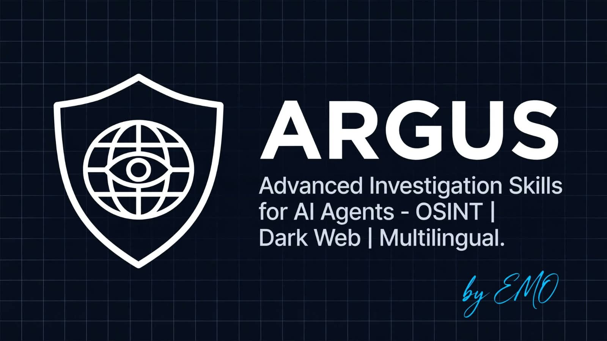

<div align="center">



# ARGUS

### AI assistants guess. ARGUS verifies.

[](https://pypi.org/project/emo-argus/)
[](https://pypi.org/project/emo-argus/)
[](LICENSE)
[](https://github.com/SE-Emam/EMO-ARGUS/actions)

**One command turns a vague question into a sourced, multilingual research report — with dead links and uncited claims caught before delivery.**

[Install](#install) · [Quick Start](#quick-start) · [7 Modes](#the-7-modes) · [Docs](#documentation) · [Extensions](#extensions)

</div>

---

## Why ARGUS?

| Without ARGUS | With ARGUS |
|---|---|
| Single-language, Google-only answers | **14 languages** by default (Arabic, Chinese, Spanish, Russian, Hindi...) |
| Invented links you discover too late | **`verify` gate** checks structure, live links, citations, and language coverage |
| "Deep research" = one long paragraph | **7 modes** from 100-word quick answers to 5,000-word deep reports |
| Scraping / forums happen silently | **Explicit consent gates** — silence always means SKIP |
| Agent does random tool calls | **Fixed 5-wave method** — broad → regional → technical → discussion → verify |

> **Zero-dependency core:** the CLI is pure Python stdlib. No supply-chain risk, auditable line by line, runs even in air-gapped environments.

---

## Install

```bash
pip install emo-argus
argus modes
```

That's it. You now have the `argus` command. Works on Python 3.9+.

<details>
<summary>Why <code>emo-argus</code> and not <code>argus</code>?</summary>

The name `argus` is taken on PyPI since 2015 by an unrelated camera-calibration package. Our distribution is `emo-argus`, but it installs the exact same `argus` + `argus-mcp` commands. After install you just type `argus`.

</details>

### For AI Agents (Claude Code, Cursor, Copilot)

```bash
pip install "emo-argus[mcp]"
argus-mcp
```

### Docker (Institutional / Air-gapped)

```bash
docker build -f docs/docker/Dockerfile -t argus .
docker run --rm argus plan "ARGUS: compare Notion vs Obsidian"
```

---

## Quick Start

```bash
# 1. See the plan before anything runs
argus plan "ARGUS: compare Notion vs Obsidian"

# 2. Generate a verified report skeleton
argus report "ARGUS: deep AI startups in Africa" --output ./output

# 3. Preview any public Telegram channel (no login needed)
argus preview durov --limit 5

# 4. Audit any report before you trust it
argus verify ./output/argus-report-*.md --offline
```

Output: a Markdown report with YAML frontmatter, executive summary, verified findings, contested claims, sources grouped by language, and a consent log.

---

## The 7 Modes

| Mode | Trigger | Use it when | Output |
|---|---|---|---|
| `quick` | `quick` | One fact, fast | 100–300 words |
| `compare` | `compare` | X vs Y | Table + 1,000–2,000 words |
| `deep` | `deep` | "Research this properly" | 2,000–5,000 words, 14 languages |
| `platform` | `platform` | One platform (YouTube, X, Reddit) | 1,500–3,000 words |
| `timebox` | `timebox` | "What happened in 2024–2026?" | Timeline + 1,500–3,500 words |
| `region` | `region` | One geography | 2,000–4,000 words + regional engines |
| `narrow` | `narrow` | One tight question, deep | 800–1,500 words |

```text
ARGUS: quick who is the CEO of OpenAI
ARGUS: compare Notion vs Obsidian
ARGUS: deep African fintech landscape 2026
ARGUS: platform AI agents on Twitter last 30 days
```

Full detail: [`docs/MODES.md`](docs/MODES.md) · Filters: [`docs/FILTERS.md`](docs/FILTERS.md) · Tools: [`docs/TOOLS.md`](docs/TOOLS.md)

---

## ARGUS Lite — Institutional Preset

Built for admin teams, academic researchers, and data analysts who need fast, simple, and safe research without advanced field complexity.

```bash
argus-lite plan "compare Q3 vs Q4 financial reports"
# or explicitly:
argus --profile institutional plan "compare Q3 vs Q4 financial reports"
```

| Full (default) | Lite (institutional) |
|---|---|
| 7 modes | 3 modes: quick, compare, regional |
| Consent gates on scraping, forums, restricted | Gates silent for routine queries |
| Verify: structure + links + citations + languages + consent | Verify: structure + links only |

---

## Agent Skills

[`docs/SKILL.md`](docs/SKILL.md) is a **prompt specification for AI agents** (Claude, Cursor, Copilot, etc.) — not a runnable application. It describes the 5-wave research methodology, tool routing rules, consent workflows, and quality standards that an agent should follow when conducting research on your behalf.

**No Docker required.** Every ARGUS component runs natively:

| Component | How to run | Docker needed? |
|---|---|---|
| CLI (`argus`) | `pip install emo-argus` | No |
| MCP Server (`argus-mcp`) | `pip install "emo-argus[mcp]"` | No |
| Bridge (`argus-bridge`) | Included in `pip install emo-argus` | No |
| Chrome / VSCode Extensions | Load unpacked / build VSIX | No |
| Agent Skill (`SKILL.md`) | Copy into your agent's skill/prompt directory | No |

Docker is an **optional** deployment method for institutional or air-gapped environments only.

---

## Extensions

Extend ARGUS into your daily workflow with browser and editor companions. Both connect to your local ARGUS core via a secure loopback bridge — **no external network, no cloud**.

| Extension | What it does | Install |
|---|---|---|
| **Chrome Companion** | Capture page context, quick-verify snippets via side panel | [Load unpacked](argus-chrome-extension/README.md) |
| **VSCode Companion** | Verify selections, plan from editor, insert report templates | [VSIX / dev setup](argus-vscode-extension/README.md) |

Start the local bridge first:

```bash
argus-bridge
# Paste the printed token into the extension settings
```

Full extension docs: [`docs/EXTENSION.md`](docs/EXTENSION.md)

---

## Safety

> No scraping, no forums/Telegram deep search, no dark web, no login-bypass — without asking you first and getting an explicit `Y`. **Silence = SKIP, always.**

- MCP server runs on stdio/localhost only
- Bridge listens on `127.0.0.1` only with token authentication
- All paths validated against traversal attacks
- Atomic file writes prevent corruption

---

## Configuration

| Environment Variable | Default | Description |
|---|---|---|
| `ARGUS_PREVIEW_TIMEOUT` | `25` | Telegram preview fetch timeout (seconds) |
| `ARGUS_VERIFY_TIMEOUT` | `8` | Link liveness check timeout (seconds) |
| `ARGUS_LOG_FORMAT` | _(text)_ | Set to `json` for structured JSON logging |
| `ARGUS_LOG_LEVEL` | `WARNING` | Logging level (DEBUG, INFO, WARNING, ERROR) |

---

## Documentation

| I want to... | Open |
|---|---|
| Daily use, 5-step flow, FAQ | [`docs/USER_GUIDE.md`](docs/USER_GUIDE.md) |
| Modes, filters, tool routing | [`docs/MODES.md`](docs/MODES.md) · [`docs/FILTERS.md`](docs/FILTERS.md) · [`docs/TOOLS.md`](docs/TOOLS.md) |
| Agent skill spec (advanced) | [`docs/SKILL.md`](docs/SKILL.md) |
| Browser & editor extensions | [`docs/EXTENSION.md`](docs/EXTENSION.md) |
| Architecture decisions | [`docs/DECISIONS.md`](docs/DECISIONS.md) |
| What changed | [`docs/CHANGELOG.md`](docs/CHANGELOG.md) |
| Contributing guidelines | [`docs/CONTRIBUTING.md`](docs/CONTRIBUTING.md) |

---

## License

Apache License 2.0 — see [LICENSE](LICENSE).